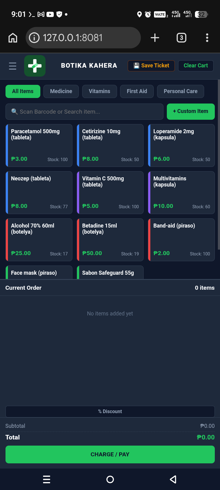
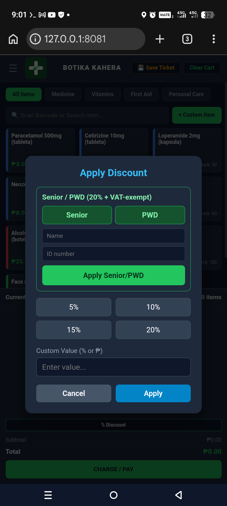
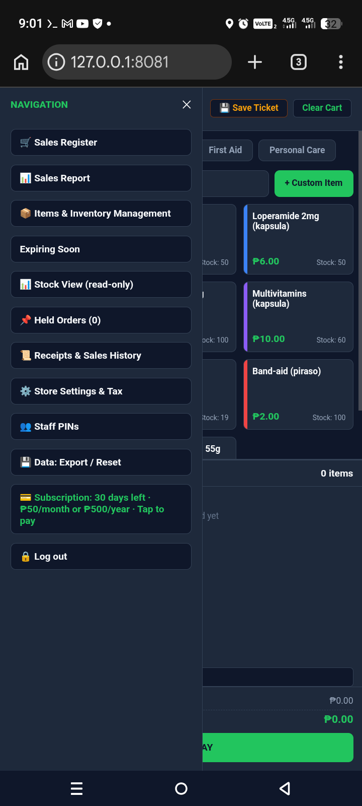

# Totskie Botika

Simple POS for small pharmacies (botika). Flask + SQLite.

Features: sales, inventory, Senior/PWD discount, FEFO expiry tracking, lot numbers, reports, PIN login.

Run: pip install flask, then python app.py

Telegram alerts are optional: copy telegram.example.json to telegram.json.

## Screenshots

